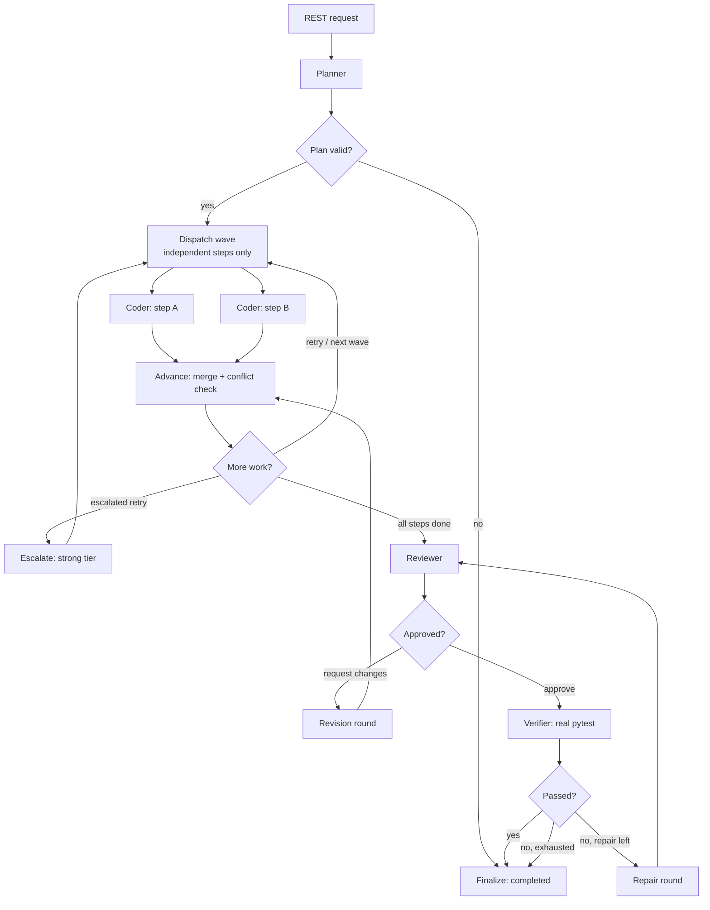

# SwarmOS

**Adaptive multi-agent coding orchestration — explicit state, bounded autonomy, and a trace you can audit.**

SwarmOS turns one coding goal into a plan, fans out independent coding subtasks in parallel, reviews the result, and runs the tests. Every agent invocation, routing decision, verification result, retry, escalation, and failure is recorded in SQLite and rendered in a React trace viewer.

It runs fully offline with a deterministic demo fixture, and against local open-weight models through any OpenAI-compatible endpoint (Ollama, vLLM, llama.cpp server, LM Studio). No paid API is required.

---

## Status, stated plainly

| Area | State |
| --- | --- |
| LangGraph orchestration, conditional routing, parallel dependency waves | Implemented, tested |
| Typed state and typed agent inputs/outputs | Implemented, tested |
| Bounded retries, revisions, escalations | Implemented, tested |
| Call, wall-clock, and conditional USD limits | Implemented, tested |
| SQLite runs and append-only trace | Implemented, tested |
| Real pytest verification in a temp workspace | Implemented, tested |
| OpenAI-compatible adapter (local first) | Implemented, **mock-tested only** |
| Role → model-profile routing, honest fallback | Implemented, tested |
| React dashboard with provider/model provenance | Implemented, type-checked, built |
| Benchmark harness (fixed / adaptive / multi-agent) | Implemented, demo-measured |
| Live local-model end-to-end run | **Not yet performed** (no runtime installed here) |
| Kernel sandbox / network isolation | **Not implemented** |
| Live repository checkout, commit, or push | **Not implemented** |
| Multi-provider orchestration | **Not implemented** (one endpoint per run) |

Mock-HTTP tests prove the adapter's request/response handling. They are not evidence of a real inference call. See [docs/providers.md](docs/providers.md).

## Architecture



Four roles:

- **Planner** — emits a `Plan` of steps with dependencies, acceptance criteria, and target files.
- **Coding Agent** — receives one step plus the workspace snapshot, returns complete-file `FileChange`s, and works in an isolated per-step checkout.
- **Review Agent** — inspects the merged workspace against acceptance criteria and returns `approve` or `request_changes` with typed findings.
- **Verification Agent** — no model: runs the configured command, captures exit code and output, and parses pass/fail counts.

Details: [architecture](docs/architecture.md), [providers](docs/providers.md), [safety](docs/safety.md), and the [audit](docs/audit.md) of the original prototype.

## Quickstart (offline demo)

Requires Python 3.11+. The demo needs no model and no credentials.

```bash
python -m venv .venv
# Windows PowerShell
.venv\Scripts\Activate.ps1
# macOS / Linux
# source .venv/bin/activate

pip install -e ".[dev]"
```

```bash
swarmos run "Implement tag normalization so the failing tests pass" --provider demo
swarmos trace <run_id>
```

The demo plans three steps, runs two in parallel, implements `normalize_tags`, writes change notes, reviews, and then really runs `python -m pytest -q` in the temporary workspace. Only the model's reasoning is scripted; verification and the trace are real.

## Local open-weight inference

Install and start a compatible runtime, then point SwarmOS at it. Example with Ollama:

```bash
ollama pull qwen2.5-coder:7b
ollama serve
```

`.env`:

```dotenv
SWARMOS_PROVIDER=openai
OPENAI_COMPAT_BASE_URL=http://127.0.0.1:11434/v1
OPENAI_COMPAT_API_KEY=
OPENAI_COMPAT_MODEL_FAST=qwen2.5-coder:7b
OPENAI_COMPAT_MODEL_STRONG=
```

Check reachability and whether your model id is actually present, without running inference:

```bash
swarmos doctor
```

Then:

```bash
swarmos run "Implement tag normalization so the failing tests pass" --provider openai \
  --policy adaptive --budget 0 --max-calls 8 --max-retries 1 --max-escalations 0
```

`OPENAI_COMPAT_MODEL_STRONG` must be a **different** model id to enable escalation. If it is absent or identical, SwarmOS reports escalation as unavailable instead of calling the fast model twice. An API key is optional locally and required for hosted endpoints.

No hosted provider is assumed to be free, and SwarmOS does not assume any chat product exposes its internal models over HTTP.

## Providers and models

| Setting | Purpose |
| --- | --- |
| `SWARMOS_PROVIDER` | `auto` / `demo` / `openai` default |
| `OPENAI_COMPAT_BASE_URL` | endpoint root, including `/v1` if required |
| `OPENAI_COMPAT_API_KEY` | optional bearer token |
| `OPENAI_COMPAT_MODEL_FAST` | required fast profile |
| `OPENAI_COMPAT_MODEL_STRONG` | optional distinct strong profile |
| `SWARMOS_ROLE_MODELS` | e.g. `planner=strong,coder=fast,reviewer=strong` |
| `SWARMOS_MODEL_POLICY` | `config` / `fast_only` / `adaptive` / `role_routed` |
| `SWARMOS_JSON_MODE` | request JSON mode; downgraded once if rejected |

All four roles run the same graph under every policy; policies only change model selection and escalation. Full reference: [.env.example](.env.example) and [docs/providers.md](docs/providers.md).

## API

| Method | Path | Purpose |
| --- | --- | --- |
| `GET` | `/health` | Liveness, provider kind, auth status |
| `GET` | `/api/config` | Profiles, routing, caps, safety flags |
| `GET` | `/api/provider/models` | List models from the endpoint (no inference) |
| `POST` | `/api/runs?wait=true` | Create and execute a run inline |
| `POST` | `/api/runs` | Create a run in the background (`202`) |
| `GET` | `/api/runs` | Recent runs |
| `GET` | `/api/runs/{id}` | Run record plus every trace event |
| `GET` | `/api/runs/{id}/events` | Trace events only |

Set `SWARMOS_API_TOKEN` to require `Authorization: Bearer <token>` on every `/api` route. The CLI refuses a non-loopback bind unless the token is set and `SWARMOS_ALLOW_REMOTE_BIND=1`.

### Dashboard

```bash
cd frontend
npm install
npm run dev        # http://localhost:5173, proxying to the API on :8000
```

For a single process:

```bash
cd frontend && npm run build && cd ..
uvicorn app.main:app
# http://localhost:8000
```

The dashboard shows run status, dependency waves, agent invocations, routing decisions, verification evidence, errors, resource meters, the actual provider kind, and the model used by each role. Demo runs are labelled as fixtures.

## How autonomy is bounded

| Control | Behaviour |
| --- | --- |
| `max_agent_calls` | The ledger refuses the next call; the run ends `limit_exceeded` |
| `max_wall_seconds` | A call after the deadline is refused |
| `max_retries` | Coding attempts per step, plus repair rounds after failed verification |
| `max_revisions` | Review → revise cycles |
| `max_escalations` | Bounded switch to a configured strong profile |
| `max_budget_usd` | Enforced **only** when both input and output token rates are configured |

USD honesty: with unknown pricing the run reports **"Monetary budget: NOT enforced"** and relies on call, time, retry, and revision limits. Even when enforced, cost is reserved before a call and settled after, so one in-flight call may exceed the cap by its actual cost. Missing usage metadata is recorded as unavailable, never estimated.

## Execution safety

- A binary allowlist (`python`, `pytest`, …) and no shell.
- `SWARMOS_EXECUTION_ENABLED=0` disables execution entirely.
- Timeouts kill the process tree.
- Test subprocesses get a filtered environment without provider keys.
- Path traversal, absolute paths, and symlinks are refused.
- Real repository copying is opt-in and skips `.git`, `.env*`, keys, and databases.

This is containment, not a sandbox: there is no kernel isolation or network block. Do not expose the API publicly without authentication and a container. Full details: [docs/safety.md](docs/safety.md).

## Evaluation

```bash
swarmos bench --provider demo --out benchmarks/results/demo.jsonl
swarmos bench --provider openai --policy fixed-fast adaptive multi-agent --budget 0
```

All policies run the same graph and differ only in model selection. The harness records status, verification, calls, retries, escalations, duration, tokens, and cost **only when reported**. It withholds a cost comparison when usage or pricing is missing and never declares a winner.

Tasks are in `benchmarks/tasks.jsonl`; results are written to `benchmarks/results/`, which is git-ignored.

## Tests

```bash
python -m pytest
ruff check .
cd frontend && npx tsc --noEmit && npm run build
```

The suite covers typed contracts, plan validation, routing, wave independence, parallel execution, conflict rejection, retries and escalation, budget and call limits, review revisions, verification repair, provider error classification, JSON-mode downgrade, workspace safety, persistence and migration, the benchmark harness, and the HTTP API.

## Project layout

```
app/
  orchestrator.py      LangGraph wiring, routing rules, run record assembly
  state.py             Explicit shared state and reducers
  models.py            Typed contracts for every agent boundary
  store.py             SQLite runs + append-only trace events, with migration
  service.py           Run lifecycle, provider/policy resolution, limit clamping
  main.py              FastAPI surface, optional auth, static dashboard
  benchmark.py         Reproducible policy comparison
  agents/              Planner, coder, reviewer, verifier, call runner
  providers/           Provider protocol, demo fixture, OpenAI-compatible adapter
  runtime/             Budget ledger, isolated workspace, trace recorder
frontend/src/          React trace viewer
samples/sample_project Failing-test fixture used by demo runs
tests/                 Pytest suite
docs/                  Architecture, providers, safety, audit
```

## Limitations

- The adapter has not been run against a live model in this environment. Treat the
  first real run as a validation step, not a formality.
- One endpoint per run. No cross-provider fallback, so this is not yet multi-provider
  orchestration.
- Verification is contained by path checks, a filtered environment, a binary
  allowlist, and a timeout — not a kernel sandbox. Do not run untrusted code.
- Orchestration is in-process: no worker queue, checkpoint/resume, or cancellation.
- There is no live repository workflow (clone, branch, diff, commit, push).
- The planner is one model call; conflicting parallel writes are rejected rather than
  re-planned.
- The workspace snapshot is capped in characters and silently truncated at the limit;
  there is no token-aware context budgeting.
- The demo provider is scripted for the bundled sample. Use a configured model for
  custom seed files.
- Cost is an estimate from configured token rates, not a provider invoice.
- The API serves the built dashboard only when `frontend/dist` exists.

## Roadmap

1. Validate the adapter against a live local model and record the trace.
2. Durable checkpoint/resume and a worker-backed executor.
3. Container or namespace isolation for verification.
4. Live repository checkout with branch and diff support.
5. Token-aware context budgeting.
6. Comparative benchmark with recorded traces and measured results.

## License

MIT. See [LICENSE](LICENSE).