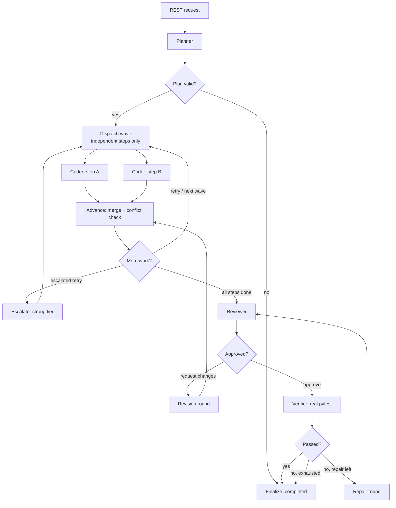

# SwarmOS

**Adaptive multi-agent coding orchestration — explicit state, bounded autonomy, and a trace you can audit.**

SwarmOS turns one coding goal into a plan, fans out independent coding subtasks in parallel, reviews the result, and runs the tests. Every agent invocation, routing decision, verification result, retry, escalation, and failure is recorded in SQLite and rendered in a React trace viewer.

It runs fully offline with a deterministic demo fixture, and against local open-weight models through any OpenAI-compatible endpoint (Ollama, vLLM, llama.cpp server, LM Studio). No paid API is required.

---

## Status, stated plainly

| Area | State |
| --- | --- |
| LangGraph orchestration, conditional routing, parallel dependency waves | Implemented, tested |
| Typed state and typed agent inputs/outputs | Implemented, tested |
| Bounded retries, revisions, escalations | Implemented, tested |
| Call, wall-clock, and conditional USD limits | Implemented, tested |
| SQLite runs and append-only trace | Implemented, tested |
| Real pytest verification in a temp workspace | Implemented, tested |
| Diagnostic verification on rejected runs | Real; recorded without changing the verdict |
| OpenAI-compatible adapter (local first) | Implemented, **mock-tested only** |
| Role → model-profile routing, honest fallback | Implemented, tested |
| React dashboard with provider/model provenance | Implemented, type-checked, built |
| Benchmark harness (fixed / adaptive / multi-agent) | Implemented, demo-measured |
| Live local-model end-to-end run | **Not yet performed** (no runtime installed here) |
| Kernel sandbox / network isolation | **Not implemented** |
| Live repository checkout, commit, or push | **Not implemented** |
| Multi-provider orchestration | **Not implemented** (one endpoint per run) |

Mock-HTTP tests prove the adapter's request/response handling. They are not evidence of a real inference call. See [docs/providers.md](docs/providers.md).

## Architecture



Four roles:

- **Planner** — emits a `Plan` of steps with dependencies, acceptance criteria, and target files.
- **Coding Agent** — receives one step plus the workspace snapshot, returns complete-file `FileChange`s, and works in an isolated per-step checkout.
- **Review Agent** — inspects the merged workspace against acceptance criteria and returns `approve` or `request_changes` with typed findings.
- **Verification Agent** — no model: runs the configured command, captures exit code and output, and parses pass/fail counts.

Details: [architecture](docs/architecture.md), [providers](docs/providers.md), [safety](docs/safety.md), and the [audit](docs/audit.md) of the original prototype.

## Quickstart (offline demo)

Requires Python 3.11+. The demo needs no model and no credentials.

```bash
python -m venv .venv
# Windows PowerShell
.venv\Scripts\Activate.ps1
# macOS / Linux
# source .venv/bin/activate

pip install -e ".[dev]"
```

```bash
swarmos run "Implement tag normalization so the failing tests pass" --provider demo
swarmos trace <run_id>
```

The demo plans three steps, runs two in parallel, implements `normalize_tags`, writes change notes, reviews, and then really runs `python -m pytest -q` in the temporary workspace. Only the model's reasoning is scripted; verification and the trace are real.

## Local open-weight inference

Install and start a compatible runtime, then point SwarmOS at it. Example with Ollama:

```bash
ollama pull qwen2.5-coder:7b
ollama serve
```

`.env`:

```dotenv
SWARMOS_PROVIDER=openai
OPENAI_COMPAT_BASE_URL=http://127.0.0.1:11434/v1
OPENAI_COMPAT_API_KEY=
OPENAI_COMPAT_MODEL_FAST=qwen2.5-coder:7b
OPENAI_COMPAT_MODEL_STRONG=
```

Check reachability and whether your model id is actually present, without running inference:

```bash
swarmos doctor
```

Then run the constrained demo:

```bash
swarmos demo --provider openai
```

`swarmos demo` uses the canonical `sample_tag_normalization` recipe: one step, `target.py` only, and `tests/test_target.py` is read-only. The plan is supplied by the recipe, so the **planner model is skipped** and the trace says so. The **coder, reviewer, and verifier still run for real**, and verification executes the existing three tests with `python -m pytest -q`. Limits are 6 agent calls, 0 retries, 1 revision, 0 escalations, and the existing 120-second wall clock. Use `--provider demo` for the same recipe with the deterministic fixture.

For an unconstrained task:

```bash
swarmos run "Implement tag normalization so the failing tests pass" --provider openai \
  --policy adaptive --budget 0.50 --max-calls 8 --max-retries 1 --max-escalations 0
```

`--budget 0.50` is a soft USD cap. It only takes effect once you configure
token rates (`FAST_*_USD_PER_MILLION` and friends); with no rates configured the
cap is inactive and the call, time, retry, and revision limits are the real
controls. Do not pass `--budget 0` to mean "unlimited": when rates *are*
configured, a zero cap refuses every call and the run fails immediately with
`budget_exceeded`. Leave the default, or set a real cap.

`OPENAI_COMPAT_MODEL_STRONG` must be a **different** model id to enable escalation. If it is absent or identical, SwarmOS reports escalation as unavailable instead of calling the fast model twice. An API key is optional locally and required for hosted endpoints.

No hosted provider is assumed to be free, and SwarmOS does not assume any chat product exposes its internal models over HTTP.

## Providers and models

| Setting | Purpose |
| --- | --- |
| `SWARMOS_PROVIDER` | `auto` / `demo` / `openai` default |
| `OPENAI_COMPAT_BASE_URL` | endpoint root, including `/v1` if required |
| `OPENAI_COMPAT_API_KEY` | optional bearer token |
| `OPENAI_COMPAT_MODEL_FAST` | required fast profile |
| `OPENAI_COMPAT_MODEL_STRONG` | optional distinct strong profile |
| `SWARMOS_ROLE_MODELS` | e.g. `planner=strong,coder=fast,reviewer=strong` |
| `SWARMOS_MODEL_POLICY` | `config` / `fast_only` / `adaptive` / `role_routed` |
| `SWARMOS_JSON_MODE` | request JSON mode; downgraded once if rejected |

All four roles run the same graph under every policy; policies only change model selection and escalation. Full reference: [.env.example](.env.example) and [docs/providers.md](docs/providers.md).

## API

| Method | Path | Purpose |
| --- | --- | --- |
| `GET` | `/health` | Liveness, provider kind, auth status |
| `GET` | `/api/config` | Profiles, routing, caps, safety flags |
| `GET` | `/api/provider/models` | List models from the endpoint (no inference) |
| `POST` | `/api/runs?wait=true` | Create and execute a run inline |
| `POST` | `/api/runs` | Create a run in the background (`202`) |
| `GET` | `/api/runs` | Recent runs |
| `GET` | `/api/runs/{id}` | Run record plus every trace event |
| `GET` | `/api/runs/{id}/events` | Trace events only |

Set `SWARMOS_API_TOKEN` to require `Authorization: Bearer <token>` on every `/api` route. The CLI refuses a non-loopback bind unless the token is set and `SWARMOS_ALLOW_REMOTE_BIND=1`.

### Dashboard

```bash
cd frontend
npm install
npm run dev        # http://localhost:5173, proxying to the API on :8000
```

For a single process:

```bash
cd frontend && npm run build && cd ..
uvicorn app.main:app
# http://localhost:8000
```

The dashboard shows run status, dependency waves, agent invocations, routing decisions, verification
evidence, errors, resource meters, the actual provider kind, and the model used by each role. Demo runs are
labelled as fixtures. It also provides:

- **Provider status** - configured profiles, role routing, pricing state, and a model-list check
  against the endpoint. The check lists models only; it never runs inference.
- **Compare policies** - runs the same goal under `fast_only`, `adaptive`, and `role_routed`,
  then shows status, verification, calls, retries, escalations, revision rounds, duration,
  tokens and cost side by side. It warns when escalation is inert and never declares a winner.
  This starts three independent runs, so with a priced provider total spend can be up to
  three times a single run.
- **Download trace JSON** - the complete run record and every trace event for offline review.

## How autonomy is bounded

| Control | Behaviour |
| --- | --- |
| `max_agent_calls` | The ledger refuses the next call; the run ends `limit_exceeded` |
| `max_wall_seconds` | A call after the deadline is refused |
| `max_retries` | Coding attempts per step, plus repair rounds after failed verification |
| `max_revisions` | Revision rounds dispatched after a review rejection |
| `max_escalations` | Bounded switch to a configured strong profile |
| `max_budget_usd` | A **soft** cap, enforced only when both input and output token rates are configured. Not a hard limit — see below. |

USD honesty: with unknown pricing the run reports **"Monetary budget: NOT enforced"** and relies on call, time, retry, and revision limits. Even when rates are configured, the cap is **not a strict hard limit**: cost is reserved before a call and settled afterwards, so a call already in flight can exceed the cap by its own cost, and several parallel in-flight calls can collectively exceed the configured cap before any of them settles. The cap bounds the spend of calls that have not started yet; it does not bound the total spend of the run. The call count and the wall clock are the limits that are always enforced. Missing usage metadata is recorded as unavailable, never estimated.

## Execution safety

- A binary allowlist (`python`, `pytest`, …) and no shell.
- `SWARMOS_EXECUTION_ENABLED=0` disables execution entirely.
- Timeouts kill the process tree.
- Test subprocesses get a filtered environment without provider keys.
- Path traversal, absolute paths, and symlinks are refused.
- Real repository copying is opt-in and skips `.git`, `.env*`, keys, and databases.

This is containment, not a sandbox: there is no kernel isolation or network block. Do not expose the API publicly without authentication and a container. Full details: [docs/safety.md](docs/safety.md).

## Evaluation

```bash
swarmos bench --provider demo --out benchmarks/results/demo.jsonl
swarmos bench --provider openai --policy fixed-fast adaptive multi-agent --budget 0.50
```

All policies run the same graph and differ only in model selection. The harness records status, verification, calls, retries, escalations, duration, tokens, and cost **only when reported**. It withholds a cost comparison when usage or pricing is missing and never declares a winner.

`--budget` defaults to `0` for `bench`. As with `run`, a zero cap is not
"unlimited": once token rates are configured it refuses every call. Pass a real
cap such as `--budget 0.50`, or omit it when no rates are configured.

The summary warns explicitly when a policy that is supposed to escalate cannot
select a distinct stronger model. In that case the escalating policies produce
the same numbers as the non-escalating one **by construction**, so equal
results are not evidence that the policies are equivalent.

Tasks are in `benchmarks/tasks.jsonl`; results are written to `benchmarks/results/`, which is git-ignored.

### Deterministic policy scenarios

The task suite above needs a provider. The scenario suite does not: it drives the
real orchestrator with a scripted provider, an in-memory database, and the
bundled fixture, so a matrix run is reproducible and needs no API key or network.

```bash
swarmos bench --suite scenarios
swarmos bench --suite scenarios --policy fixed-fast adaptive \
  --scenario first_try_success revision_required escalation_recovery \
  --json-report benchmarks/results/policy-benchmark.json \
  --markdown benchmarks/results/policy-benchmark.md
```

The seventeen scenarios cover first-attempt success, a revision round, a genuine
blocker, insufficient reviewer evidence, a malformed review, malformed planner,
coder, and reviewer output, a transient provider timeout, a verification
failure, a verification timeout, disabled execution, escalation recovery, the
escalation limit, unavailable escalation, the revision limit, and the call
limit. Each is run under `fixed-fast`, `adaptive`, and `multi-agent`.
`docs/evaluation.md` lists every scenario's expected status, verification
behaviour, review behaviour, and budget constraint.

Per run the harness records the outcome, planner/coder/reviewer call counts,
revision rounds, reviewer rejections, invalid reviews, evidence-gap events,
verification attempts, exit code and result, escalations, denied calls,
wall-clock time, and token/cost figures **only when the provider reports them**.
Unreported tokens and costs are written as `null`, never as zero.

The JSON report keeps `task_id`, `policy`, `run_id`, and a stable configuration
fingerprint so repeated runs can be compared; the Markdown summary carries the
per-task table, per-policy aggregates, denominators, failures, limit exhaustion,
run identifiers, and trade-off statements derived from the measurements.
Neither output declares a winner. Add `--bench-db benchmarks/results/scenarios.db`
to keep the runs inspectable in the dashboard.

> The scripted provider simulates model *behaviour*. These numbers measure
> orchestration cost and policy behaviour, not the quality of any real model.
> `docs/evaluation.md` documents the controlled real-model procedure.

## Tests

```bash
python -m pytest
ruff check .
cd frontend && npx tsc --noEmit && npm run build
```

The suite covers typed contracts, plan validation, routing, wave independence, parallel execution, conflict rejection, retries and escalation, budget and call limits, review revisions, verification repair, provider error classification, JSON-mode downgrade, workspace safety, persistence and migration, the benchmark harness, and the HTTP API.

## Project layout

```
app/
  orchestrator.py      LangGraph wiring, routing rules, run record assembly
  state.py             Explicit shared state and reducers
  models.py            Typed contracts for every agent boundary
  store.py             SQLite runs + append-only trace events, with migration
  service.py           Run lifecycle, provider/policy resolution, limit clamping
  main.py              FastAPI surface, optional auth, static dashboard
  benchmark.py         Reproducible policy comparison
  agents/              Planner, coder, reviewer, verifier, call runner
  providers/           Provider protocol, demo fixture, OpenAI-compatible adapter
  runtime/             Budget ledger, isolated workspace, trace recorder
frontend/src/          React trace viewer
samples/sample_project Failing-test fixture used by demo runs
tests/                 Pytest suite
docs/                  Architecture, providers, safety, audit
```

## Limitations

- The adapter has not been run against a live model in this environment. Treat the
  first real run as a validation step, not a formality.
- One endpoint per run. No cross-provider fallback, so this is not yet multi-provider
  orchestration.
- Verification is contained by path checks, a filtered environment, a binary
  allowlist, and a timeout — not a kernel sandbox. Do not run untrusted code.
- Orchestration is in-process: no worker queue, checkpoint/resume, or cancellation.
- There is no live repository workflow (clone, branch, diff, commit, push).
- The planner is one model call; conflicting parallel writes are rejected rather than
  re-planned.
- The workspace snapshot is capped in characters and silently truncated at the limit;
  there is no token-aware context budgeting.
- The demo provider is scripted for the bundled sample. Use a configured model for
  custom seed files.
- Cost is an estimate from configured token rates, not a provider invoice.
- The API serves the built dashboard only when `frontend/dist` exists.

## Roadmap

1. Validate the adapter against a live local model and record the trace.
2. Durable checkpoint/resume and a worker-backed executor.
3. Container or namespace isolation for verification.
4. Live repository checkout with branch and diff support.
5. Token-aware context budgeting.
6. Comparative benchmark with recorded traces and measured results.

## License

MIT. See [LICENSE](LICENSE).
