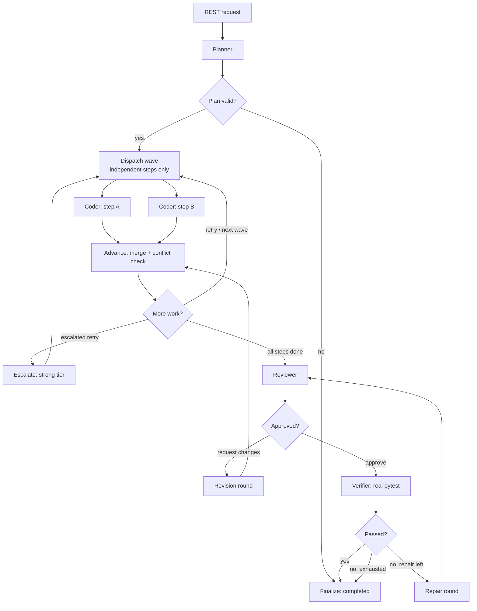

# SwarmOS

**Adaptive multi-agent coding orchestration — explicit state, bounded autonomy, and a trace you can audit.**

SwarmOS turns one coding goal into a plan, fans out independent coding subtasks in parallel, reviews the result, and runs the tests. Every agent invocation, routing decision, verification result, retry, escalation, and failure is recorded in SQLite and rendered in a React trace viewer.

---

## What is real, and what is a fixture

This is an MVP. It is honest about which parts are real:

| Capability | Status |
| --- | --- |
| LangGraph orchestration, conditional routing, parallel waves | Real |
| Typed agent inputs/outputs and shared state | Real |
| Bounded retries, one-step escalation, review revisions, repair rounds | Real |
| Budget, call-count, and wall-clock enforcement | Real |
| SQLite run + trace persistence | Real |
| Verification (runs the real test command in a temp workspace) | Real |
| React trace viewer and API | Real |
| Model reasoning in the default `demo` provider | **Simulated fixture** |
| Kernel-level sandboxing / network isolation | **Not implemented** |

The default run needs no model credentials. The `demo` provider is a deterministic fixture that plays the model's role against the bundled sample project. Everything around it — planning data, routing, parallel execution, budget accounting, retries, the test run, and the trace — is the real system. Configure an OpenAI-compatible endpoint to replace the fixture with a model; no orchestration code changes.

## Architecture



Four roles with typed contracts:

- **Planner** — emits a `Plan` of steps with dependencies, acceptance criteria, and target files.
- **Coding Agent** — receives one step plus the workspace snapshot, returns complete-file `FileChange`s, and works in an isolated per-step checkout.
- **Review Agent** — inspects the merged workspace against acceptance criteria and returns `approve` or `request_changes` with typed findings.
- **Verification Agent** — no model: runs the configured command, captures exit code and output, and parses pass/fail counts.

See `docs/architecture.md` for the state machine, failure semantics, trust boundaries, and schema. See `docs/audit.md` for the gap analysis against the previous prototype.

## Providers and configuration

`SWARMOS_PROVIDER` selects how agents call a model:

- `demo` — deterministic fixture. No credentials, no model calls, no cost.
- `openai` — any OpenAI-compatible `/chat/completions` endpoint. Requires `OPENAI_COMPAT_BASE_URL`, `OPENAI_COMPAT_API_KEY`, and `OPENAI_COMPAT_MODEL_FAST`; `OPENAI_COMPAT_MODEL_STRONG` is optional.
- `auto` — uses the configured endpoint when all three required values are present, otherwise the demo fixture and a visible warning.

Token rates (`FAST_*_USD_PER_MILLION`, `STRONG_*_USD_PER_MILLION`) are estimates, not a provider invoice. Per-run ceilings (`SWARMOS_MAX_*`), the verification command, the SQLite path (`SWARMOS_DB_PATH`, default `swarmos.db`), and the dashboard dist path are documented with defaults in `.env.example`. Copy it to `.env` and edit; `.env` is git-ignored.

## Quickstart

Requires Python 3.11+ and (for the dashboard) Node 20+.

```bash
python -m venv .venv
# Windows PowerShell
.venv\Scripts\Activate.ps1
# macOS / Linux
# source .venv/bin/activate

pip install -e ".[dev]"

# Optional: demo mode needs no credentials.
copy .env.example .env      # Windows
# cp .env.example .env      # macOS / Linux
```

Run the API:

```bash
uvicorn app.main:app --reload
```

Or from the CLI:

```bash
swarmos serve --reload
```

### One-command demo (no UI)

```bash
swarmos run "Implement tag normalization so the failing tests pass" --provider demo
swarmos trace <run_id>
```

The demo plans three steps, runs two in parallel, implements `normalize_tags`, writes change notes, reviews, and then really runs `python -m pytest -q` in the temporary workspace.

### Dashboard

```bash
cd frontend
npm install
npm run dev        # http://localhost:5173, proxying to the API on :8000
```

For a single process, build the UI once and let FastAPI serve it:

```bash
cd frontend && npm run build && cd ..
uvicorn app.main:app
# http://localhost:8000
```

## API

| Method | Path | Purpose |
| --- | --- | --- |
| `GET` | `/health` | Liveness and provider mode |
| `GET` | `/api/config` | Caps, verification command, sample files |
| `POST` | `/api/runs?wait=true` | Create and execute a run inline |
| `POST` | `/api/runs` | Create a run in the background (`202`) |
| `GET` | `/api/runs` | Recent runs |
| `GET` | `/api/runs/{id}` | Run record plus every trace event |
| `GET` | `/api/runs/{id}/events` | Trace events only |

```bash
curl -X POST "http://localhost:8000/api/runs?wait=true" ^
  -H "Content-Type: application/json" ^
  -d "{\"goal\":\"Implement tag normalization so the failing tests pass\",\"provider\":\"demo\",\"limits\":{\"max_budget_usd\":0.05,\"max_agent_calls\":12}}"
```

Run limits are validated against the process ceiling in `.env`; a request can tighten a limit but never widen it.

## How autonomy is bounded

| Control | Behaviour |
| --- | --- |
| `max_agent_calls` | The ledger refuses the next call; the run ends `limit_exceeded` |
| `max_budget_usd` | Cost is reserved before each call and settled after; overshoot is refused |
| `max_wall_seconds` | A call after the deadline is refused |
| `max_retries` | Coding attempts per step, plus repair rounds after failed verification |
| `max_revisions` | Review → revise cycles |
| `max_escalations` | One switch from the fast tier to the strong tier after retries are exhausted |

USD enforcement requires configured per-token rates. With rates at `0` the honest cost estimate is zero, so the call and wall-clock limits are the effective guards; this is stated in the trace and the run summary rather than pretending the budget applied.

## Tests

```bash
python -m pytest
```

The suite covers the typed contracts, plan validation (cycles, unknown deps), routing, wave independence, parallel execution, conflict rejection, bounded retries and escalation, budget and call limits, review revisions, verification repair, unparseable model output, the isolated test runner (including secret non-leakage and timeouts), persistence, and the HTTP API.

```bash
ruff check .
```

## Project layout

```
app/
  orchestrator.py      LangGraph wiring, routing rules, run record assembly
  state.py             Explicit shared state and reducers
  models.py            Typed contracts for every agent boundary
  store.py             SQLite runs + append-only trace events
  service.py           Run lifecycle and limit clamping
  main.py              FastAPI surface + static dashboard
  agents/              Planner, coder, reviewer, verifier, call runner
  providers/           Provider protocol, demo fixture, OpenAI-compatible adapter
  runtime/             Budget ledger, isolated workspace, trace recorder
frontend/src/          React trace viewer
samples/sample_project Failing-test fixture used by demo runs
tests/                 Pytest suite
docs/                  Architecture and audit notes
```

## Limitations

- Verification is contained by path checks, a filtered environment, and a timeout — not by a kernel sandbox. Do not point it at untrusted code.
- Orchestration runs in-process. There is no worker queue, crash-resume, or distributed execution yet.
- The planner is one model call, not a search or critique loop.
- Parallelism is wave-level: steps in the same dependency wave run together, and conflicting writes to one file are rejected rather than merged.
- The demo provider is scripted for the bundled sample project. With custom seed files, use a configured provider for meaningful coding output.
- Cost is an estimate from configured token rates, not a provider invoice.
- The workspace snapshot sent to an agent is capped at 400k characters, and there is no context-window budgeting or chunked retrieval yet.
- The API serves the built dashboard only when `frontend/dist` exists. There is no UI-level test suite; the frontend is checked by `tsc --noEmit` and `vite build`.

## Roadmap

1. Durable checkpoint/resume for in-flight runs and a worker-backed executor.
2. Stronger isolation (container or firejail profile) for verification.
3. Plan critique and automatic dependency repair when conflicts are detected.
4. Comparative benchmark across fixed, adaptive, and parallel policies with recorded traces.
5. Multi-run analytics over the SQLite trace store.

## License

MIT