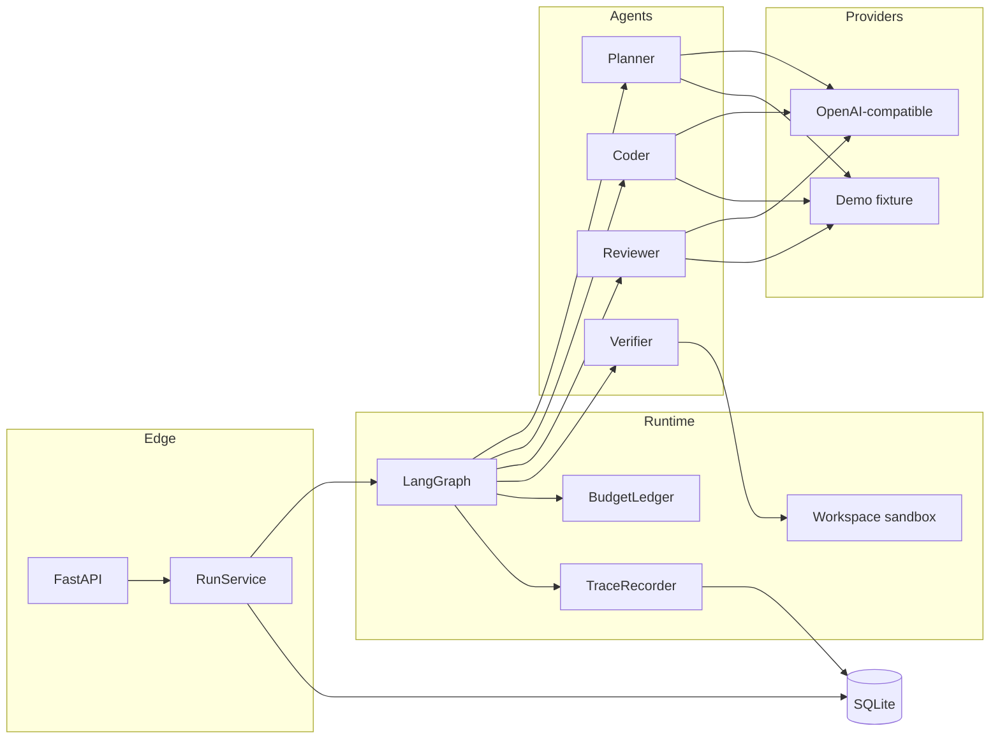
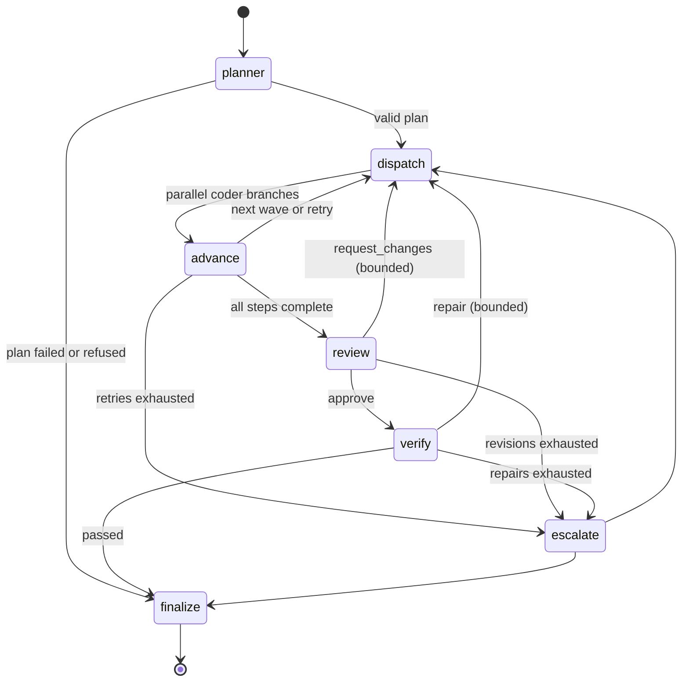
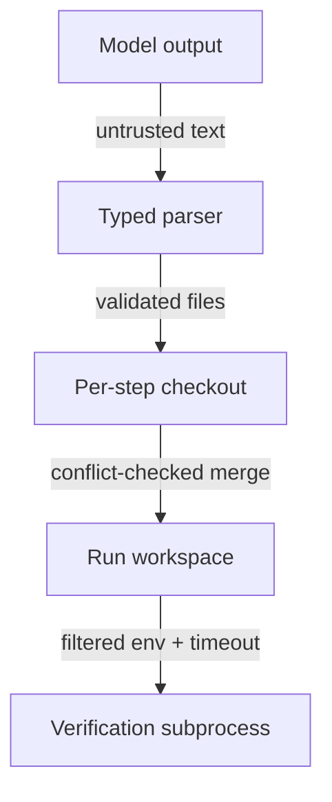
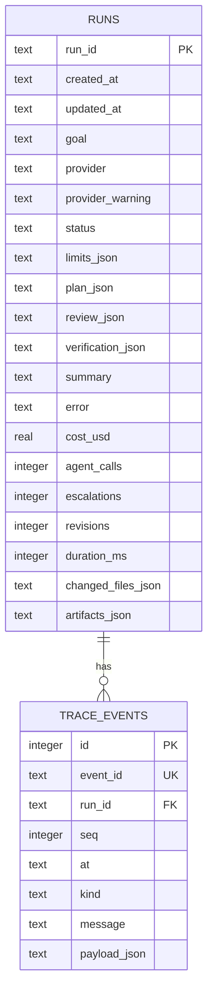
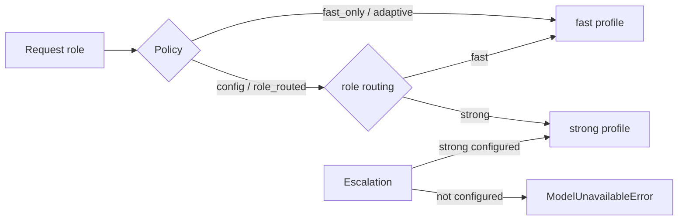

# Architecture

## Components



`RunService` resolves the provider, clamps the requested limits against the process ceiling, creates a run record, and hands execution to the graph. The graph is compiled per run and closes over a `RunRuntime` that owns the provider, ledger, trace recorder, and temporary workspace.

## Shared state

`SwarmState` is a `TypedDict`. Channels that parallel branches write carry a reducer; every other channel has exactly one serial writer. This makes concurrent fan-out safe by construction.

| Channel | Writer | Reducer |
| --- | --- | --- |
| `goal`, `limits`, `provider`, `started_at` | service | — |
| `plan`, `model_tier`, `workspace` | planner / escalate / advance | — |
| `completed_steps`, `merged_coded`, `merged_changes` | advance | — |
| `review`, `pending_review_steps`, `revisions` | review | — |
| `verification`, `verification_attempts` | verify | — |
| `escalations`, `stage`, `status`, `error`, `summary` | serial nodes | — |
| `changes`, `coded_steps`, `failures`, `halt` | code_step / advance | list concat |
| `agent_invocations` | any agent call | list concat |
| `cost_usd`, `agent_calls` | any agent call | numeric add |
| `attempts` | code_step | per-key max |

A coding branch reports success on `coded_steps`, never on `completed_steps`. Only `advance` marks a step complete after merge validation, so a rejected conflict cannot be mistaken for success.

## Graph



| Source | Condition | Target |
| --- | --- | --- |
| planner | plan exists and a step is ready | `Send` per ready step |
| planner | no plan, halted, or failed | finalize |
| advance | unresolved failure with attempts left | `Send` retry |
| advance | unresolved failure, escalation available | escalate |
| advance | ready steps remain | `Send` next wave |
| advance | steps remain but none are ready | finalize |
| advance | all steps complete | review |
| review | `approve` | verify |
| review | `request_changes`, revisions left | `Send` revision |
| review | `request_changes`, no revisions, escalation available | escalate |
| verify | passed | finalize |
| verify | failed, repair rounds left | `Send` repair |
| verify | failed, escalation available | escalate |
| escalate | review, failure, or verification work remains | `Send` the corresponding batch |

Steps are dispatched only when all of `depends_on` are complete, so every `Send` batch is mutually independent. Revision and repair batches use the earliest plan wave that intersects the target steps for the same reason.

## Failure semantics

| Situation | Result |
| --- | --- |
| Planner cannot produce a valid typed plan | `failed`, no coding starts |
| Coder returns invalid JSON | Attempt fails; bounded retry, then escalation |
| Coder answers for a different step | Attempt fails; treated as invalid output |
| Two independent steps write the same file | Both writes rejected as a conflict; retry/escalation or fail |
| Reviewer requests changes | Revision rounds up to `max_revisions` |
| Reviewer still rejects after the limit | `completed_with_findings` (changes exist, not approved) |
| Verification fails | Repair rounds up to `max_retries`, then fail |
| Ledger refuses a call | `budget_exceeded` or `limit_exceeded` |
| Unexpected graph exception | `failed`, with the exception recorded in the trace |

## Trust boundaries



1. **Model output is untrusted.** It is parsed into a Pydantic model; paths are normalized and rejected if absolute, traversing, or too long. File count and size per step are capped.
2. **Coding branches are isolated.** Each step gets its own checkout under the run's temp root, and the checkout is destroyed after the branch returns. The canonical workspace changes only in `advance`.
3. **Verification is contained, not sandboxed.** The subprocess inherits only an allow-listed environment (`PATH`, `SYSTEMROOT`, `TEMP`, `PYTHONPATH`, …), so provider credentials cannot leak into test code. It runs with a wall-clock timeout. There is no filesystem namespace, cgroup, or network block.

## Persistence



Events are appended as they happen, so the dashboard can follow a live run. `run_id` is a foreign key; the service persists the run row before execution begins.

## Provider abstraction

`Provider` is a protocol with one async method:

```python
class Provider(Protocol):
    name: str
    async def complete(self, request: ModelRequest) -> ModelResponse: ...
```

Providers report text and token usage. The runtime owns pricing (`Settings.rates_for`), reservations, and settlement. Two implementations ship:

- `DemoProvider` — deterministic, role-aware, scripted for the sample workspace.
- `OpenAICompatibleProvider` — generic chat-completions transport with a timeout and typed errors.

SwarmOS makes no assumption that a hosted assistant exposes its internal models. If no endpoint is configured, runs use the fixture and say so in the run record, the trace, and the UI.

## Model selection, errors, and safety

An API key is optional; only the base URL and fast model id are required. Requests
carry `temperature: 0.1` and, when enabled, `response_format: json_object`, which is
downgraded once if the server rejects it.

`RunRuntime.selection_for_role(role)` resolves a `ModelProfile` (`fast` or `strong`)
under the active policy. `selection_for_tier("strong")` raises
`ModelUnavailableError` rather than silently returning the fast model, so an
unavailable escalation is recorded as unavailable.



`ProviderError` carries `category`, `retryable`, `status_code`, and optionally
`retry_after_seconds`. The call runner retries only `rate_limit`, `timeout`,
`connection`, and `server`, with exponential backoff. `auth`, `bad_request`,
`not_found`, and `invalid_response` fail fast. Invalid structured output is retried
with a repair note containing the parser error.

The Verification Agent runs the configured command inside the run's temporary
workspace. Execution is gated by `SWARMOS_EXECUTION_ENABLED`, restricted by a binary
allowlist (no shell), bounded by a timeout that kills the process tree, and given a
filtered environment so provider credentials are not inherited. This is containment,
not a sandbox: there is no kernel isolation or network block. See
[safety.md](safety.md).

Runs also record `provider_kind`, `model_policy`, `models_by_role`,
`monetary_enforced`, and `usage_available`. Existing databases are migrated on open
by adding missing columns with defaults; no data is rewritten.

## Extension points

- **New agent role:** subclass `Agent[InputT, OutputT]`, add a node, and route to it. Typed inputs keep prompts and parsing together.
- **New provider:** implement `Provider`, register it in `resolve_provider`.
- **Different verification:** change `SWARMOS_VERIFY_COMMAND`; the verifier parses `N passed` / `N failed` and treats an empty suite as not passing.
- **Durable execution:** the graph is checkpoint-ready; adding a LangGraph checkpointer and a worker queue is the next step.